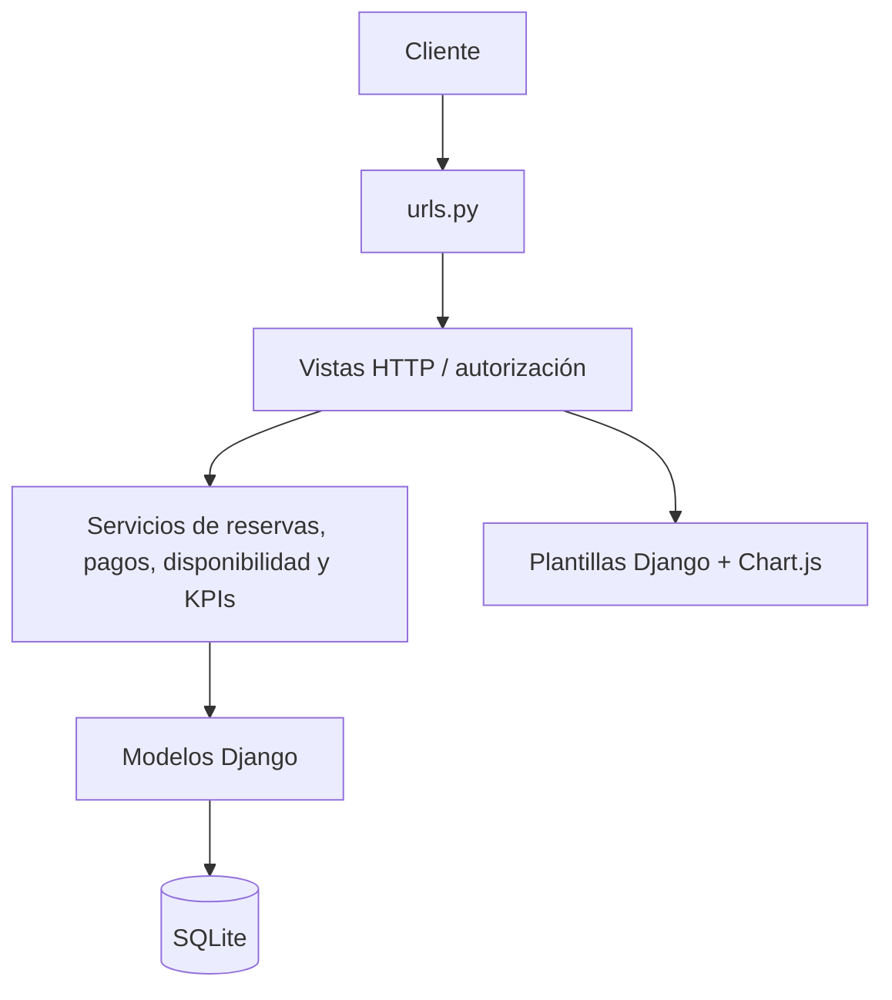

# Arquitectura técnica · Paso 2

## Tecnología y libertad tecnológica
Se conserva Python 3.12 o superior, Django 5.2 (versión fijada en requirements.txt),
SQLite, plantillas Django, Tailwind 2.2.19 por CDN y Chart.js 4.4.1 por CDN.
El enunciado permite elegir tecnología: continuar esta base evita una migración y
nuevas dependencias. Python estándar basta para las agregaciones; no se requiere pandas.
La zona horaria del proyecto es America/Panama; la persistencia usa fechas conscientes.

## Capas y carpetas
- `gestor_reservas/`: configuración y enrutamiento global.
- `reservas/urls.py`: rutas; `views.py` y `views_front.py`: HTTP y front de clientes;
  `views_admin.py`: filtros y autorización del nuevo panel.
- `reservas/services/reservas.py`: BR-01 (hay_conflicto), BR-02 a BR-05
  (_validar y crear_reservas) y BR-07 (cancelar_reserva).
- `reservas/services/pagos.py`: BR-08, cálculo de importe y transacción reserva/pago.
- `reservas/services/disponibilidad.py`: disponibilidad visible; `demanda.py`: panel histórico;
  `notificaciones.py`: correos posteriores al commit; `kpis.py`: lectura y cálculo de KPIs.
- `reservas/models.py` y `migrations/`: entidades, relaciones y restricciones persistentes.
- `reservas/templates/` y `static/`: presentación; `templates/reservas/admin/panel.html`
  hereda base.html y contiene sus estilos específicos y los gráficos.
- `reservas/forms_cuenta.py`: BR-09; autenticación de creación (BR-06) en views.py.
- `specs/`, `docs/`, `reservas/tests/`: contrato, decisiones y validación.

## RF-06 / BR-01: única definición de solape
`hay_conflicto` evalúa `inicio_a < fin_b AND fin_a > inicio_b` contra reservas
confirmadas y bloqueos; permite franjas adyacentes e ignora las canceladas.
`crear_reservas` comprueba cada repetición dentro de transaction.atomic y revierte
el conjunto al encontrar conflicto. El flujo de clientes es:
`api_crear_reserva → reservar_y_pagar → crear_reservas → hay_conflicto`.
El endpoint transforma ConflictoHorario en HTTP 409; el front nunca es la autoridad.
`Booking.clean()` también delega a hay_conflicto (formularios del admin).
No se cambia el comportamiento del servicio existente.

### Límite verificado y pendiente fuera del alcance de archivos
No es correcto afirmar que toda escritura pasa por crear_reservas:
`management/commands/crear_reservas_demo.py` usa objects.create y
`generar_historico.py` usa bulk_create, con controles propios. El admin valida
mediante clean, pero guarda mediante ModelForm. Un save/create ORM directo no invoca
clean automáticamente. La restricción única parcial protege franjas exactamente
iguales, no todo solape parcial ni carreras concurrentes. SQLite y atomic por sí
solos no garantizan exclusión de intervalos concurrentes. Se reporta en #2 para
coordinar cambios en archivos ajenos; no se alteran los comandos, modelos ni admin.

## RF-08 / AC-10: contrato de indicadores
El panel GET /panel/ requiere staff activo. Por defecto muestra hoy y los 29 días
anteriores. `desde` y `hasta` son fechas inclusivas, en hora local; la consulta interna
es [medianoche desde, medianoche posterior a hasta). Se aceptan hasta 366 días y
se rechazan entradas inválidas con 400; una cancha inexistente da 404.

`calcular_kpis(desde, hasta, cancha=None)` carga datos mediante ORM sin escribir;
`resumir_kpis` es el núcleo puro: recibe datos explícitos, rango y cancha opcional,
sin consultas, reloj ni efectos secundarios. `variacion` también es pura.
- Reservas totales y cancelaciones: reservas cuyo inicio cae en el rango; cancelación
  es el estado actual, no eventos por cancelled_at. Porcentaje = canceladas / total.
- Ocupación y ranking: duración de reservas confirmadas que intersectan el rango,
  recortada a sus límites. Capacidad teórica = 12 horas × días × canchas seleccionadas;
  los bloqueos no restan capacidad (definición solicitada).
- Horas pico: cantidad de reservas confirmadas que intersectan cada hora local 09–20;
  una reserva larga cuenta en cada hora tocada. Se muestran todos los empates.
- Ingresos y serie diaria: suma Decimal de Payment aprobado por created_at del pago,
  aunque la reserva esté cancelada o su fecha de juego fuera del rango. No hay reembolsos.
- Ticket promedio: ingresos / cantidad de pagos aprobados del rango, no reservas sin pago.
- Clientes nuevos: usuarios no staff ni superusuarios por date_joined; es una métrica
  global incluso al filtrar cancha (un usuario no pertenece a una cancha).
- Variaciones: cambio porcentual contra período inmediatamente anterior de igual
  duración y cancha; si ambos valores son cero, 0%; si solo el anterior es cero,
  «Sin base anterior». Cero denominadores produce cero en los indicadores.

Las tarjetas, tabla y resumen de horas pico funcionan sin JavaScript. Los gráficos
usan json_script para serializar datos sin interpolar nombres en JavaScript.
